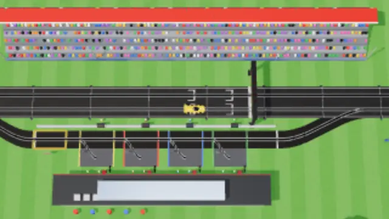
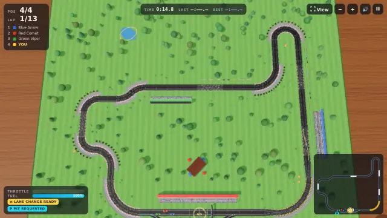

# Graphics presets

Low, Balanced and High change one thing: how many pixels the 3D scene draws. The selector is on the title and pause screens. The definitions are in `src/graphics.ts`.

## Policy

Renderer pixel ratio = `min(preset cap, actual devicePixelRatio)`. A missing or invalid device ratio counts as 1.

| Preset | Cap | Why |
| --- | --- | --- |
| Low | 0.5 | Must be under 1, or a DPR 1 display gains nothing. Draws a quarter of the pixels of Balanced. |
| Balanced (default) | 1 | One drawn pixel per CSS pixel. Same as the old picture on DPR 1. |
| High | 2 | The old `min(2, DPR)` policy, so it is the existing picture. |

- **Unchanged in every preset:** antialiasing, environment and PBR lighting, the 2048 shadow map, tone mapping, meshes and scenery. Only resolution changes because the 6 November investigation found a shadows-only change insufficient (also SwiftShader, so a diagnostic).
- **Storage:** `srgp.graphics` holds `low`, `balanced` or `high`. A missing or invalid value, or unavailable storage, gives Balanced. If storage is blocked, the choice still applies for the session.
- **Applying:** changes apply at once. Resizes and DPR changes re-apply the policy; the DPR is checked every frame, because moving to another display may not fire `resize`.
- **What stays full resolution:** canvas CSS size, camera aspect (taken from the window) and the DOM HUD do not depend on the preset. The minimap canvas follows the device ratio, not the preset, and now also updates when the DPR changes.
- **Keyboard:** Tab reaches the group, and the arrow keys change the preset and wrap. Space and Enter on the selector do not start or resume a race. Esc and other game keys still work.

## Trade-offs

- Low looks visibly soft: fine track rails and crowds blur in the close view. In the full-circuit view the rails shimmer and the lane arrow gets thin. The player marker, HUD chips and minimap stay clear.
- Balanced is the default, so anyone on a DPR 2 display now gets a softer picture than before until they choose High. That is a quarter of the pixels they drew before.
- At DPR 1, Balanced and High are the same, because the device ratio is the limit. At a DPR of 0.5 or below (browser zoomed far out), all three are the same.
- Frame time does not fall in line with pixel count, in this software renderer at least: a quarter of the pixels took about 40% of the time. Shadows and about 440 draw calls are not reduced by any preset.

## Evidence

**All results are SwiftShader diagnostics. The build host has no GPU, no real GPU was tested, and nothing here shows an improvement on real hardware.** The frame times are not targets.

| Field | Value |
| --- | --- |
| Before build | `fce6d35` (main with the timing fix), built before any graphics change and sampled alongside the after build so both saw the same host load |
| After build | `70e91f2` |
| Renderer | ANGLE, Vulkan 1.3.0, SwiftShader Device (Subzero); headless Chromium 156.0.8078.4; 4 vCPU |
| Viewport | 1280×720 CSS pixels |
| Track and camera | `circuit-1` (Clubman Park); follow camera, span 30, centred on the player |
| Scene | Seeded `Math.random`, race advanced 14 s, then simulation frozen, so every sample draws the same 444 calls and 198,572 triangles |

### Drawing buffer and frame time

Read from `canvas.width` and `canvas.height`. CSS size was 1280×720 in every row. Frame time is the gap between `requestAnimationFrame` callbacks over 20 s after an 8 s warm-up, in two interleaved rounds. Cells are round 1 / round 2.

| DPR | Build and preset | Drawing buffer | Pixels | Median ms | p95 ms | Frames |
| --- | --- | --- | --- | --- | --- | --- |
| 1 | Before | 1280×720 | 921,600 | 967 / 1033 | 1833 / 2233 | 23 / 16 |
| 1 | Low | 640×360 | 230,400 | 417 / 417 | 800 / 767 | 47 / 46 |
| 1 | Balanced | 1280×720 | 921,600 | 1000 / 967 | 2017 / 1933 | 18 / 26 |
| 1 | High | 1280×720 | 921,600 | 1033 / 917 | 2100 / 2083 | 19 / 24 |
| 2 | Before | 2560×1440 | 3,686,400 | 3167 / 3433 | 6433 / 6966 | 8 / 8 |
| 2 | Low | 640×360 | 230,400 | 417 / 467 | 783 / 567 | 49 / 42 |
| 2 | Balanced | 1280×720 | 921,600 | 1000 / 1050 | 1900 / 2183 | 23 / 22 |
| 2 | High | 2560×1440 | 3,686,400 | 3167 / 3250 | 6633 / 3667 | 8 / 8 |

Limits of this data:

- The host was shared with other jobs (1-minute load 3.8 to 5.2), and some samples have only 8 frames. Treat differences of a few percent, and all p95 values, as noise.
- Round 2 of High at DPR 2 was rerun alone after the batch hit its time limit, so it was not interleaved.

### Screenshots

Same scene, 640×360 crops at native size from DPR 1 captures. High matched the before build exactly at both DPRs (mean difference 0 of 255 after scaling to 320×180). Low differed from High by 1.3 of 255 at both DPRs, which is softening rather than a framing change.

| Before (1280×720 buffer) | Low (640×360 buffer) |
| --- | --- |
|  |  |

Low in the full-circuit view with lane and pit requests armed, scaled to half size:

### Behaviour checks

`npm run typecheck`, `npm test` (122 tests: 114 existing, 8 new in `test/graphics.test.ts`) and `npm run build` pass on Node 26.7.0. The `.nvmrc` pin (22) was not available on this host.

Run through the production build in headless Chromium at 480×270, using real keyboard input. That one-off script is not committed; `docs/validation.md` has the repeatable checks.

- **Selection:** presets select, apply, persist and reload. Missing and invalid values give Balanced, and an invalid value is left in storage on load.
- **Blocked storage:** with `localStorage` throwing, presets still apply, a race runs and there are no page errors.
- **Saves:** initials, car, leaderboard, ghost and championship entries were byte-identical after preset changes.
- **Pause:** during a championship round, switching presets left race time, all car states, phase, track, mode and championship data identical. After resuming, W, Space and P all worked.
- **Resize and DPR:** buffers followed a resize and emulated changes between DPR 1, 1.5 and 2 while CSS size stayed fixed. The minimap went 230 → 460 → 345 pixels wide with CSS width fixed at 230.

## Not tested

- Any real GPU, real high-DPR display or real move between monitors. DPR changes were emulated.
- Firefox and Safari.
- Screen reader output for the selector.

Adaptive resolution, cheaper lighting and shadow settings are left out of this change. Cheaper lighting should wait for real-hardware measurements.
