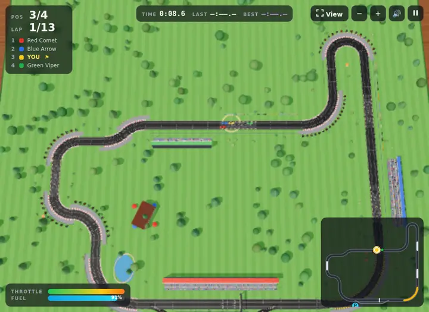
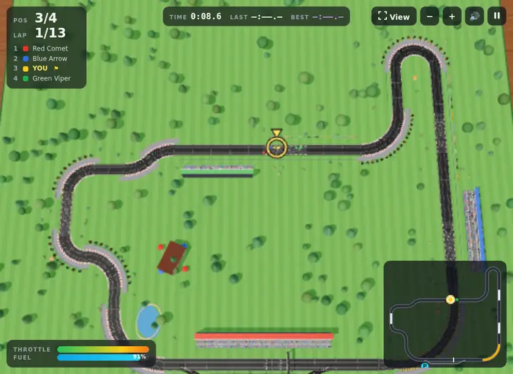
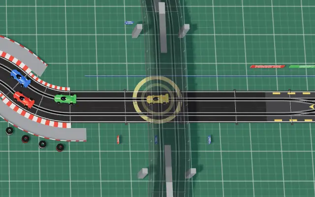
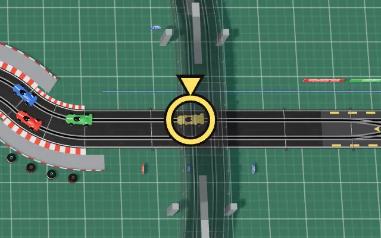

# Player marker in the full-circuit view

The 7 November partial playtest found cars too small to pick out in the full-circuit view. Handling, difficulty and race rules are unchanged: `src/race.ts` and `src/track.ts` are not touched.

## What changed

One marker replaces both the per-car ring and the separate under-bridge ring. `makePlayerMarker()` is in `src/carModel.ts` and `syncCars()` in `src/main.ts` drives it.

- **Shape:** a hollow ring with a pointer on top, yellow with a near-black outline, so it does not depend on car colour. The open centre leaves the car and close neighbours visible.
- **Size:** the ring radius holds at 20 CSS pixels when zoomed out, at any viewport or preset, and never goes below 1.25 world units, so it still surrounds the car up close.
- **Motion:** a 4% size pulse, down from 12% plus an opacity flash.
- **When shown:** in a race, pause or results screen, when the view is full-circuit, the span is over 34 (the old threshold), or the player is under a bridge and not de-slotted (the old under-bridge rule). It no longer shows behind the title screen.
- **Position:** it faces the camera and draws over everything, so decks and banked plates cannot hide or clip it. It is not part of the car's group, so it stays steady while the car blinks during tow and recovery.

During a tow the car is hidden from 0.9 s until it reaches the bay. The marker stays at the car's position for that time, then jumps to the bay with it.

## Evidence

**All browser results are SwiftShader diagnostics. The build host has no GPU, no real GPU was tested, and these runs show nothing about real hardware.** Environment: headless Chromium, ANGLE SwiftShader, Node 26.7.0. Before is `1a1ce1d`. After is this change. Random numbers were seeded and the race was stepped by script, so both builds show the same race state. That one-off script is not committed; `docs/validation.md` has the repeatable checks.

### Before and after

Clubman Park, 960×700, Low, same race moment, scaled to 720 wide:

| Before | After |
| --- | --- |
|  |  |

Bridge track (`circuit-4`), 1440×900, High at DPR 2, player under the bridge. This is a 640×400 crop in device pixels. Before shows two overlapping faint rings; after shows one marker:

| Before | After |
| --- | --- |
|  |  |

### Visibility matrix

Each combination of 960×700 and 1440×900, Low (DPR 1) and High (DPR 2), Clubman Park and `circuit-4` was captured in the full-circuit view. On `circuit-4` that included under the bridge and on the banked bend (segment 15). All 16 captures were inspected by eye.

- The marker was easy to find in every capture, including beside the opponents' pack at the chicane and at the bottom-left of the banked bend.
- **Other pixels:** on Clubman Park at 960×700 Low, no pixel outside the marker area differed from the before frame (threshold 24 summed over RGB). In the bridge frame, 113 of 5.2 million did.
- **Lane and pit arrows:** with both armed at High, the arrows and HUD chips stayed readable. They were away from the marker in that frame. The marker would draw over an arrow only where one passes right by the player.
- **HUD:** DOM controls sit above the canvas, so the marker cannot cover them. The reverse can happen: near the screen corners the car and marker can pass behind a HUD panel, as they could before.
- **Follow camera at span 24:** before and after differed by 26 to 394 pixels of 672,000 over three runs. Two runs of the same build differ by 28 to 283, so this is noise, mostly in the minimap. An earlier run with less settling time differed by 2,412 pixels; that was the camera still moving, and it did not recur.

### State checks

Scripted on `circuit-4` at 640×480 Low. Each row read the marker after the frames had drawn. Offset is the distance from the car's live position, and the 0.28 is about one simulation step, which the drawn cars trail by at speed.

| Situation | Marker | Offset |
| --- | --- | --- |
| Follow, span 20 | Hidden | n/a |
| Full view; zoomed out to span 60 | Shown | 0.28 |
| Full to follow; zoom back to 20 | Hidden within two frames at these slow frame rates | n/a |
| Under the bridge, follow and full | Shown | 0.08 |
| On the bridge | Full: shown. Follow: hidden | 0.07 |
| Banked bend, full (z 0.46, roll -0.22) | Shown | 0.06 |
| De-slotted, full | Shown | 0.12 or less |
| Recovery blink, three successive frames | Shown steadily | 0 |
| Towing, then moved to the bay | Shown | 0 |
| Pause | Shown | not read |
| Title | Hidden | n/a |

Every row had exactly one marker in the scene and no leftover ring meshes. That also held after restarts and a track change.

Not covered: a de-slot under a bridge in the follow view (by rule, as before, no marker), and the results screen.

### Resources and performance

- **Resources:** two geometries and two materials, built once at startup and kept across races. Before, every car and the ghost built a ring, and the under-bridge ring was separate. Nothing is created per frame, and there are no textures, DOM nodes or extra passes.
- **Draw calls:** full view 622 against 621 before, and 82 more triangles. Follow view is identical at 310 calls.
- **Geometry and texture counts:** flat over 60 idle frames.

Clubman Park, 1280×720, Balanced, simulation frozen, 20 s per sample, two interleaved rounds (round 1 / round 2):

| View | Build | Median ms | p95 ms | Frames |
| --- | --- | --- | --- | --- |
| Full | Before | 1150 / 1183 | 1217 / 1350 | 17 / 17 |
| Full | After | 1233 / 1100 | 1283 / 1167 | 16 / 18 |
| Follow | Before | 1117 / 1000 | 1250 / 1117 | 18 / 19 |
| Follow | After | 1133 / 1050 | 1367 / 1250 | 17 / 19 |

The rounds disagree about which build is faster, so no difference can be read from this. The host was shared (load about 4) and samples are small.

Separate from this change: the texture count rose by 4 on each drawn restart. That matches the four car number textures, which `disposeVisual` does not free. `makeCar`'s texture code is unchanged here, and the leak is left for its own fix.

### Checks

`npm run typecheck`, `npm test` (122 tests) and `npm run build` pass on Node 26.7.0. The `.nvmrc` pin (22) was not available on this host.

## Not tested

Any real GPU or real high-DPR display, Firefox and Safari, a person playing with the marker, and tracks other than `circuit-1` and `circuit-4`.
